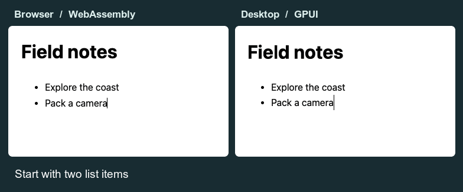

# Stratalith

Stratalith is a portable, zero-dependency Rust engine for WYSIWYG Markdown editing.

[Try the Markdown editor in your browser](https://mikecat1024.github.io/stratalith/)

- Portable. The [browser example](example/web) runs the engine as a single WebAssembly module. The [GPUI example](example/gpui) embeds the same engine natively.
- Zero dependencies. The editor core and Markdown implementation use no external crates at runtime.
- CommonMark support. The Markdown parser passes all 652 examples in the [CommonMark 0.31.2 specification](https://spec.commonmark.org/0.31.2/).

See [Editor input bindings](docs/input-bindings.md) for recommended shortcuts, their Rust commands, and the input handled by the browser adapter.
